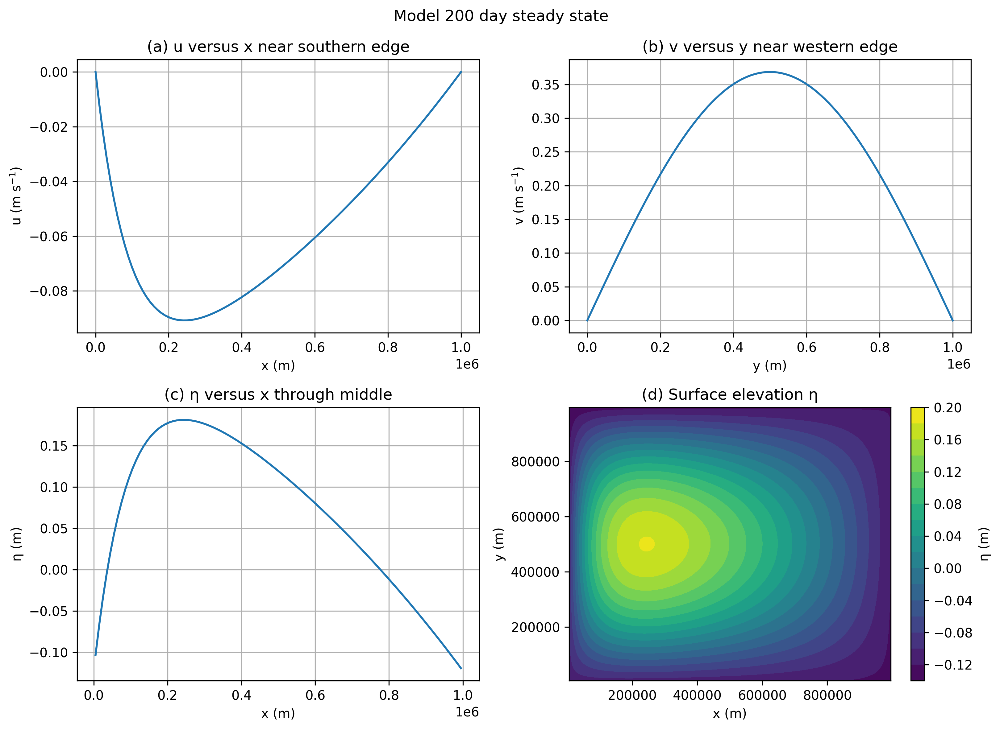

# Wind-driven ocean gyre experiments

A scientific computing study of a wind-driven ocean gyre in a closed square
basin. The project compares an analytical steady-state solution with numerical
shallow-water models on an Arakawa C-grid, then explores alternative timesteps,
nonlinear semi-Lagrangian transport, sensitivity to perturbations, and Python
and Julia implementations.

**Repository status:** the original source layout and saved experimental results
are preserved. Three import/reporting repairs have been applied and recorded;
they do not alter numerical algorithms. Automated short-run checks, including
the JAX, PhiFlow and Julia checks, are recorded in
[validation](docs/validation.md). The combined `main.py` driver is wired but
starts long experiments at module scope; use the isolated instructions below.

## Scientific objectives and methods

- Resolve the gyre circulation and western boundary structure under steady
  wind forcing, rotation on a beta-plane, and linear drag.
- Compare the numerical steady state with the analytical Stommel/Musgrave
  solution and examine energy and error changes with grid refinement.
- Compare forward-backward and fourth-order Runge-Kutta time integration.
- Explore nonlinear semi-Lagrangian integration, initial-condition sensitivity
  and continuous stochastic elevation perturbations.
- Compare independent NumPy, JAX and Julia implementations; evaluate PhiFlow's
  representation of staggered grids and differential operators.

The linear model implemented in the source is

```text
du/dt   = (f0 + beta*y)*v - g*d(eta)/dx - gamma*u + tau_x/(rho*H)
dv/dt   = -(f0 + beta*y)*u - g*d(eta)/dy - gamma*v
deta/dt = -H * (du/dx + dv/dy)
tau_x   = -tau0*cos(pi*y/L),  tau_y = 0
```

Elevation is stored at cell centres, zonal velocity at x-faces and meridional
velocity at y-faces: their array shapes are `(Ny, Nx)`, `(Ny, Nx+1)` and
`(Ny+1, Nx)`. Closed basin boundaries impose zero normal velocity. The baseline
alternates u-first and v-first forward-backward updates; one stored cycle
advances **2*dt**. RK4 and the semi-Lagrangian method advance **dt** per step.

The nonlinear semi-Lagrangian implementation uses bilinear interpolation,
clipped departure points and a predictor/trapezoidal source correction. Its
known long-run instability is part of the research record, not silently fixed.

| Parameter | Value | Units |
| --- | --- | --- |
| Basin length `L` | 1e6 | m |
| Mean depth `H` | 1000 | m |
| Gravity `g` | 10 | m s^-2 |
| Reference rotation `f0` | 1e-4 | s^-1 |
| Rotation gradient `beta` | 1e-11 | m^-1 s^-1 |
| Drag `gamma` | 1e-6 | s^-1 |
| Density `rho` | 1000 | kg m^-3 |
| Wind-stress amplitude `tau0` | 0.2 | N m^-2 |

These are the existing values in `parameters.py`; Julia defines the same
constants independently. No physical parameters were changed in preparation.

## Experiments and implementations

| Task | Files | Experiment configuration in the existing driver/source |
| --- | --- | --- |
| C | `analytical.py` | Analytical solution on a 100x100 grid |
| D/E | `diagnostics.py`, `plotting.py` | 1-day check; 200-day integration; 100x100/dt=30 s versus 200x200/dt=15 s refinement |
| F | `semi_lagrangian.py`, `task_f.py` | Nonlinear semi-Lagrangian runs; 1 and 5 days, dt=10 s in `main.py` |
| G2 | `task_g2_jax.py` | JIT-compiled forward-backward model and NumPy comparison; 64-bit arithmetic |
| G3 | `task_g3_phiflow.py` | Centred/staggered grids and a 100-repeat divergence benchmark |
| G4 | `task_g4_rk4.py` | RK4 comparison, timestep stability sweep and timing experiments |
| G5 | `task_g5_sensitivity.py` | Gaussian initial perturbations and a ten-member seeded stochastic ensemble |
| G7 | `G7_GYRE.jl`, `task_g7_julia.py` | Julia implementation and CSV comparison; 100x100, 30 days, dt=30 s in the Julia script |

The PhiFlow experiment is an operator demonstration, not a replacement gyre
solver. Function defaults can differ from the full experiment settings above;
always record explicit grid, timestep, duration and seed values.

## Historical runtime comparisons

The final report records these runtimes for separate 100x100 experiments:

| Implementation | Reported runtime | Run duration | Reported speedup over its NumPy run |
| --- | ---: | ---: | ---: |
| NumPy baseline for JAX comparison | 253.67 s | 200 days, dt=30 s | 1.00x |
| JAX compiled | 126.66 s | 200 days, dt=30 s | 2.00x |
| NumPy baseline for Julia comparison | 49.82 s | 30 days, dt=30 s | 1.00x |
| Julia | 4.72 s | 30 days, dt=30 s | 10.55x |

These are historical report values, not timings reproduced by the current test
suite. The two comparisons used different integration durations, and the source
does not establish matching hardware or benchmark conditions between them.
Therefore, the report supports saying Julia was **10.55x faster than NumPy in
its 30-day comparison** and JAX was **2.00x faster than NumPy in its separate
200-day comparison**. It does not establish a direct, controlled Julia-versus-
JAX speedup. Dividing the reported speedup factors would give about 5.28, but
that ratio is not a valid direct benchmark because the underlying runs differ.

## Installation and checks

The tested Python environment is Python 3.13.9, NumPy 2.3.5, Matplotlib 3.10.6
and pytest 8.4.2. These versions describe the preparation checks, not the
unknown original experiment environment. See [dependencies](docs/dependencies.md)
for optional backends and the limits of the direct dependency pins.

From the repository root in PowerShell with a configured Python interpreter:

```powershell
python -m venv .venv
.\.venv\Scripts\python.exe -m pip install -r requirements/test.txt
.\.venv\Scripts\python.exe scripts/verify_preservation.py
.\.venv\Scripts\python.exe -m pytest -q
```

On macOS/Linux use `.venv/bin/python`. In a publication checkout that omits the
four deliberately excluded local originals, add `--allow-excluded-missing` to
the preservation command. It still validates all files that are present.

Julia was checked using version 1.10.11. Put Julia on PATH or set `JULIA` to its
executable before running pytest to enable the Julia comparison. JAX and
PhiFlow are optional; the latest complete validation used JAX/JAXLIB 0.12.1,
PhiFlow 3.4.0 and PhiML 1.16.1. Missing optional backends produce explicit
test skips. The latest complete suite reported **31 passed, 0 skipped, 0
failed**. It included small smoke and consistency tests, not the full historical
experiment runs. See [dependencies](docs/dependencies.md) and
[validation](docs/validation.md) for versions and scope.

Tests cover analytical properties, boundary conditions, closed-basin mass
balance for the linear schemes, seeded repeatability, timestep refinement,
implementation agreement and saved-data integrity. They do not assert energy
conservation for a wind-forced, dissipative model or exact mass conservation
for the interpolating nonlinear semi-Lagrangian method.

## Reproducing experiments

Follow [the experiment guide](docs/experiments.md) to run each task in a fresh
directory beneath ignored `results/runs/`. This protects the historical CSVs
and figures from the source scripts' relative-path output commands.

The import and timing-key wiring in `main.py` has been repaired. Running
`python main.py` still imports both optional Python backends and immediately
starts long computations at module scope. Use the per-task recipes for
controlled runs; see [known issues](docs/known_issues.md) and
[repair details](docs/repairs.md).

Existing figures and CSVs are historical research artifacts. They were not
regenerated to make the checks pass, and their reported timings are not fresh
benchmarks. See [results and provenance](docs/results.md) for shapes, filenames,
missing provenance and discrepancies between reports and figure labels.

One discrepancy needs particular care: the saved RK4 figure's filename and
plot title say `dt=10 s`, while its caption in the final report says `dt=30 s`.
The original figure and report are unchanged, and the run that produced the
figure has not been established. Treat its timestep as unresolved.



*Original saved figure; inclusion here does not claim a new reproduction.*

## Project organisation

```text
*.py, G7_GYRE.jl       Existing scientific source, retained at the root
Figures/, *.csv        Original saved figures and Julia outputs
README.md, docs/       Added documentation and publication checklist
requirements/         Core, testing and optional dependency lists
pyproject.toml         Pytest configuration, not package metadata
tests/                Python tests and Julia test harness
scripts/              Preservation verification
preservation/         Original hashes and repair hashes; source backups are local-only
results/runs/         Ignored destination for new experiments
```

The full file map and proposed future Python/Julia/backend directory layout
are in [structure](docs/structure.md). No source files have been relocated.

## Preservation and publication

[The preservation record](preservation/README.md) inventories all 35 original
files before repairs. Original copies of the three repaired source files are
retained locally, and both versions are hash-checked. The `.gitignore` preserves small
reference CSVs and figures while excluding caches, environments, credentials,
temporary runs and four identified local originals.

Both local PDFs contain personal identifiers in extracted text; the C-grid
photograph also contains an identifier. Their originals are retained locally
and excluded from publication pending review. A private repository is not a
substitute for that review. Do not assume that visually covering text removes
it from a PDF.

No licence has been selected. No remote repository, GitHub authentication,
commit or push was performed. The owner will handle Git manually using the
[publication checklist](docs/publication_checklist.md).
